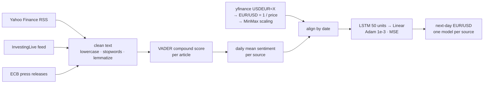
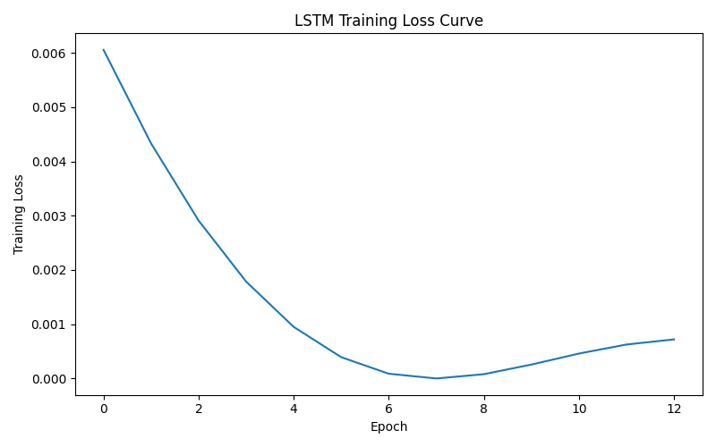
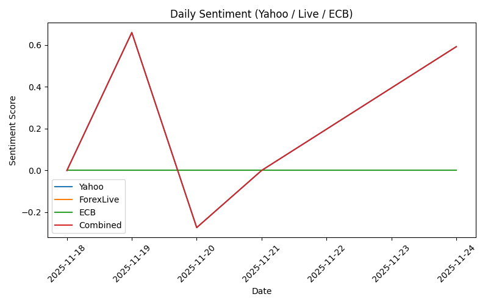
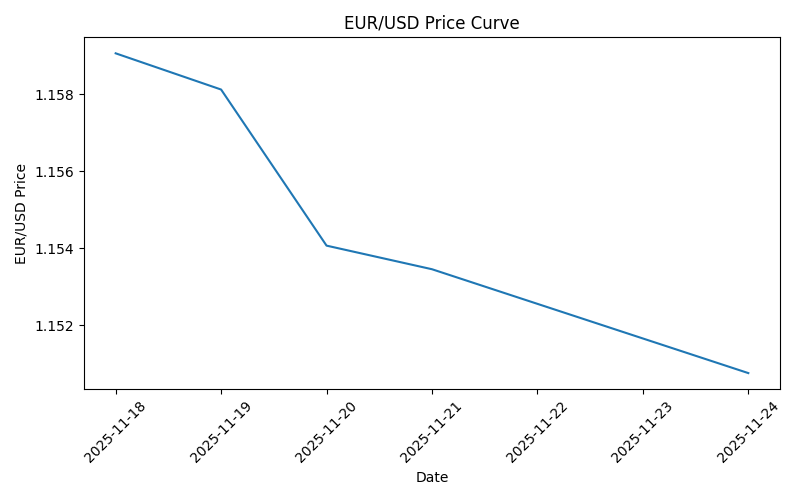

# EUR/USD Next-Day Forecasting with News Sentiment

> **Course project for DS 340 at Boston University (Fall 2025), team of two.**
> Authors: Jiahui Liang and Haoran Tu. The initial code version is in [@jiahui2284 / MULTIVERSE-S](https://github.com/jiahui2284/MULTIVERSE-S); later iterations were co-developed and exchanged offline.
> Full paper: [`report/DS340_Final_Project_Paper.pdf`](report/DS340_Final_Project_Paper.pdf).

An LSTM that predicts the next-day EUR/USD rate from daily prices plus a daily VADER sentiment score built from scraped financial news (Yahoo Finance RSS, InvestingLive/ForexLive, ECB press releases).


## Pipeline



## Highlights

- **Multi-source scraping.** RSS (feedparser) plus HTML scraping (requests + BeautifulSoup) for three sources, with keyword filtering for currency-related news and basic timeouts and error handling.
- **Text → signal.** Lowercasing, punctuation and stop-word removal and WordNet lemmatization (NLTK), then the VADER compound score per article, averaged per day.
- **Per-source comparison.** `news_prediction.py` trains one LSTM per news source on `[scaled price, that source's daily sentiment]` and prints each source's next-day prediction.
- **Reproducible report.** `generate_markdown.py` reruns the pipeline and writes an `output.md` with the prices, news listings, training logs and predictions.

## Results

| Training loss | Daily sentiment by source | EUR/USD price |
|---|---|---|
|  |  |  |

The paper reports next-day predictions that were within 0.02 of the actual rate in its runs (Section "Results").

### Retrospective: what the evidence does and does not show

The paper concludes that sentiment improves the forecast. Looking back, this data does not support that claim:

- **No baseline.** Neither the paper nor this code runs a price-only model or a naive "tomorrow = today" forecast, so any gain from sentiment cannot be isolated.
- **One effective source.** In the sentiment figure, Yahoo and ECB are flat at 0 for the whole week. Days with no articles default to 0.0 in the code, so the "combined" line is the ForexLive signal alone.
- **Very little data.** The window is Nov 18–25, 2025. In this repository's `news_prediction.py`, when there are fewer daily rows than the 7-day window the window shrinks to `len − 1`, which leaves a single training sequence; early stopping only runs with at least 5 sequences, so there is no validation split. (The loss curve in the paper stops at epoch 12, so it may come from a slightly different code version exchanged offline.)
- **Loose tolerance.** The week's entire price range is about 0.008 (≈1.159 → ≈1.151), so an error bound of 0.02 is wider than the whole movement being predicted.

**Next steps:** use months of history, add price-only and persistence baselines, evaluate with walk-forward splits and report MAE / directional accuracy, and fix the sources that return no articles.

## Tech Stack

Python 3.13 · PyTorch · scikit-learn (MinMaxScaler) · NumPy · pandas · NLTK · vaderSentiment · feedparser · requests · BeautifulSoup · yfinance · python-dateutil

## Getting Started

```bash
python -m pip install feedparser nltk vaderSentiment yfinance numpy scikit-learn torch requests beautifulsoup4 pandas python-dateutil
python news_prediction.py        # per-source predictions for the configured week
python generate_markdown.py      # same pipeline, writes output.md
```

The date range is set by `START_DATE_STR` / `END_DATE_STR` in `news_prediction.py`. NLTK stop-word and WordNet data are downloaded on first run. The scrapers depend on the live structure of the source sites, so selectors may need updates.

## Project Structure

```text
news_prediction.py      # main pipeline: scraping, sentiment, per-source LSTM, early stopping
generate_markdown.py    # runs the pipeline and writes output.md
withDataset.py          # earlier version: Yahoo RSS only, one constant average sentiment
report/
├── DS340_Final_Project_Paper.pdf
└── figures/            # figures extracted from the paper
```

## 中文说明

这是 BU DS 340 课程的双人期末项目，作者是 Jiahui Liang 和涂皓然，初版代码来自 [jiahui2284/MULTIVERSE-S](https://github.com/jiahui2284/MULTIVERSE-S)。

项目做法：从 Yahoo Finance、InvestingLive 和欧洲央行三个来源抓取新闻，用 VADER 给每篇文章打情感分并按天汇总，再与 EUR/USD 价格一起输入 LSTM，预测次日汇率。完整报告见 `report/` 目录。

回头看，这份结论站不住：

- 没有做纯价格基线，无法说明情感特征带来了提升；
- 一周里只有 ForexLive 一个来源真正有数据；
- 按本仓库代码，训练样本只有一个序列；
- 报告用的误差标准（0.02）比整周的价格波动范围（约 0.008）还大。

因此只能说：一周窗口和噪声文本不足以证明情感特征有增益。下一步应使用更长的历史数据，加入纯价格基线和滚动验证，并用 MAE 和方向准确率来评估。
